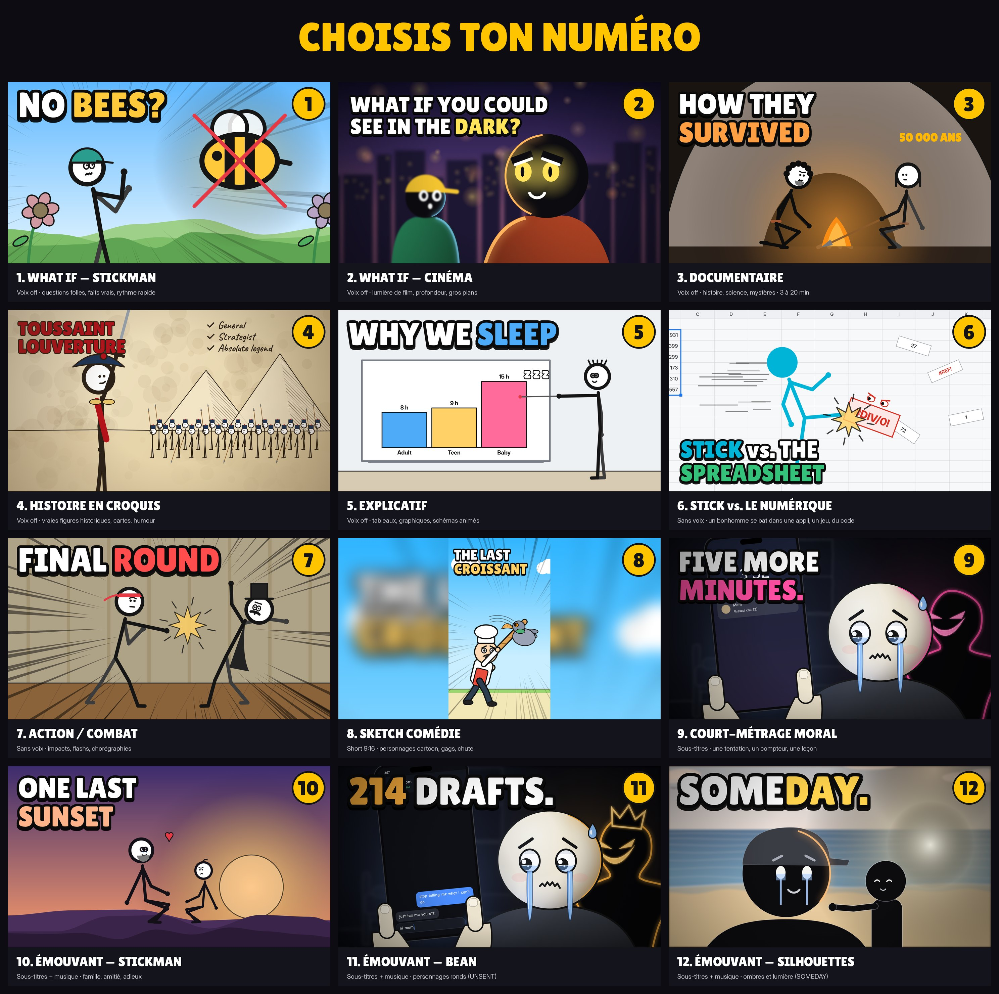

# Claude Motion Video Skill — studio d'animation pour YouTube

Un skill pour **Claude Code** qui fabrique des vidéos d'animation complètes pour YouTube, de l'idée au MP4. Il invente une histoire originale, écrit le script et anime les personnages en code. Il ajoute ensuite une voix off (ou des sous-titres), compose la musique, fait le rendu vidéo, la miniature, le titre et la description. Tout tourne sur l'ordinateur de l'élève avec [HyperFrames](https://github.com/heygen-com/hyperframes) : pas d'IA d'image ou de vidéo, pas d'abonnement.



**Au lancement**, Claude montre ce menu à l'élève, qui choisit un **numéro** : What if (stickman ou cinéma), documentaire, histoire en croquis, explicatif, stick contre le numérique, action, sketch comédie, court-métrage moral, histoires émouvantes (stickman, bean, silhouettes). Claude le mémorise pour les vidéos suivantes, puis pose 4 questions : voix ou pas, YouTube 16:9 ou Short 9:16, combien de vidéos, et s'il faut d'abord un **test de 30 secondes**.

**Claude invente tout** : l'histoire, le ton (comédie, émotion, explication, ou un mélange), les personnages et leur apparence, les décors. Il écrit le script en premier, sans se limiter à ce que le moteur sait déjà dessiner : ce qui manque, il le construit. Chaque élève obtient des vidéos différentes.

**Effets** (auras, rayons, explosions, fumée, néon, hologramme, téléportation…) inspirés du catalogue de [StykAnimate](https://github.com/Dukensn/StykAnimate-App).
**Miniatures** faites à part, en 2560×1440, avec une version JPG prête pour YouTube.
**Formats** : YouTube 16:9 (de 1 à 20 min) ou Short 9:16.
**Langues** : Claude parle avec l'élève en kreyòl, en français, en anglais… La voix off existe en anglais, français, espagnol, portugais, italien, japonais, chinois et hindi. Le kreyòl peut s'afficher en sous-titres.

**Deux voix au choix** :
- **Voix expressive (Gemini)** : elle joue chaque phrase (surprise, suspense, humour). L'élève apporte sa propre clé API Gemini, gratuite sur [aistudio.google.com/apikey](https://aistudio.google.com/apikey), et la colle dans le chat. Une vidéo = une seule requête, pour ménager le quota.
- **Voix naturelle (Kokoro)** : gratuite, sans clé, claire et naturelle, mais pas émotionnelle. C'est aussi la voix de secours si la clé manque ou si le quota est épuisé.

## Installer

**Sur téléphone (application Claude)** : chaque élève crée sa copie du dépôt (*Use this template* ou *Fork*), puis ouvre une session **Code** dessus dans l'application. Un script de démarrage installe tout automatiquement, et la vidéo arrive directement dans la conversation. Voir [GUIDE-ELEVE.md](GUIDE-ELEVE.md). Le dépôt doit être **public** (ou un dépôt modèle) pour que les élèves puissent le copier.

**Le plus simple** : dans Claude Code, coller :

> Installe le skill https://github.com/Dukensn/claude-motion-video-skill- : clone le dépôt, copie le dossier `skills/animated-video-studio` dans `~/.claude/skills/`, puis lance `bash ~/.claude/skills/animated-video-studio/scripts/setup.sh` et règle tout ce qui manque.

**Comme plugin** :

```
/plugin marketplace add Dukensn/claude-motion-video-skill-
/plugin install animated-video-studio@motion-video
```

**À la main** :

```bash
git clone https://github.com/Dukensn/claude-motion-video-skill-.git
mkdir -p ~/.claude/skills && cp -R claude-motion-video-skill-/skills/animated-video-studio ~/.claude/skills/
bash ~/.claude/skills/animated-video-studio/scripts/setup.sh
```

Il faut Node.js 18+, Python 3, ffmpeg et FluidSynth. `setup.sh` vérifie tout, installe ce qu'il peut et télécharge la voix locale (environ 330 Mo, une seule fois). Sous Windows, utilisez WSL.

## Utiliser

Dans un dossier vide, dire à Claude Code, par exemple : « Fè yon videyo stickman pou YouTube » ou « Fais-moi une vidéo What if ».

Le skill :

1. pose 4 questions (type, style, voix ou sous-titres, format) ;
2. propose **10 idées originales** et l'élève en choisit une ;
3. écrit le **script** et le montre à l'élève ;
4. anime la vidéo et montre des **planches d'images** ;
5. génère la voix, la musique et le mixage ;
6. fait le rendu MP4 ;
7. crée la miniature et le texte YouTube.

L'élève peut aussi coller le lien d'une vidéo YouTube qu'il aime : Claude l'étudie (rythme, durée des plans, accroche, sous-titres) pour s'en inspirer sans la copier. Si YouTube n'est pas accessible depuis la session, Claude demande simplement de glisser le fichier vidéo dans la conversation.

L'élève n'installe et ne configure rien lui-même : Claude lance l'installation et règle les problèmes.

Tout sort dans `./films/<nom>/`. Les trois moments marqués en gras sont faits pour le jugement de l'élève.

Voir [GUIDE-ELEVE.md](GUIDE-ELEVE.md) pour le texte à donner aux élèves.

## Contenu

```
skills/animated-video-studio/
  SKILL.md        le déroulé que Claude suit
  catalog/        le menu de lancement (12 cartes numérotées) et leur correspondance style + type
  references/     conversation, menu, création libre, attention, écriture, du script aux plans, 9 types de vidéos, API des 8 styles, effets, voix, musique, miniatures, YouTube, checklist, installation
  templates/      moteurs stickman, bean et silhouettes ; styles cinéma, numérique, croquis, cartoon et moral (chacun avec sa démo) ; effets, voix, musique, mixage, miniatures
  scripts/        setup, profile (mémoire de l'élève), ideas (idées aléatoires), new-film, audio, sheet, render, thumb (2560×1440)
  examples/       quatre courts-métrages complets (UNSENT, AGAIN, LITTLE BEAN, SOMEDAY)
  licenses/       licences des polices et de GSAP
```

Chaque histoire est neuve : `ideas.py` tire des ingrédients au hasard à chaque fois, et le skill interdit de recopier les démos, les exemples ou les chaînes existantes.
