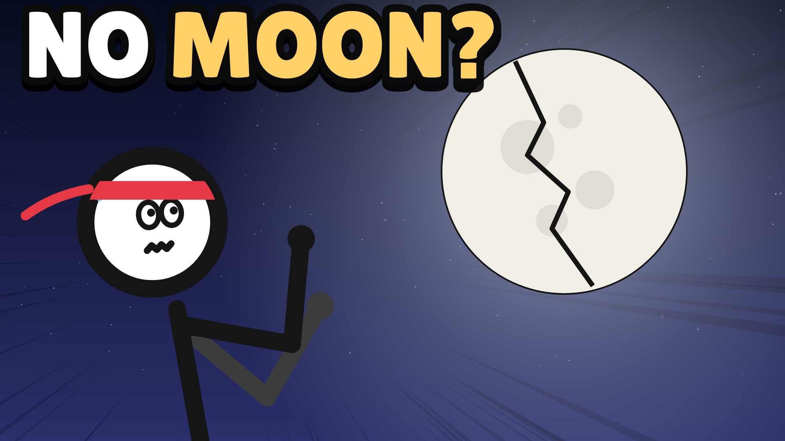
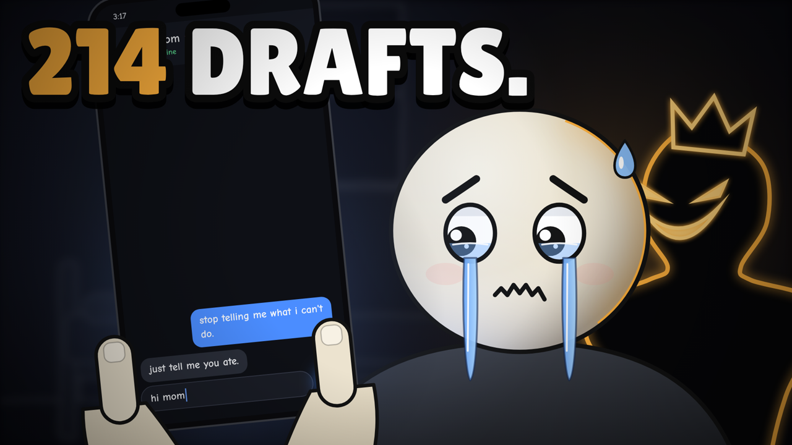
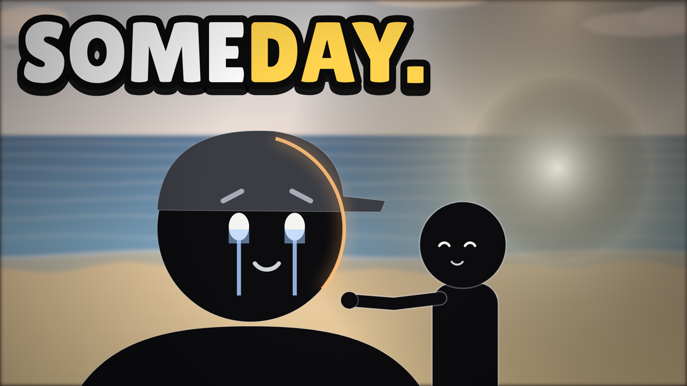

# Claude Motion Video Skill — studio d'animation pour YouTube

Un skill pour **Claude Code** qui fabrique des vidéos d'animation complètes pour YouTube, de l'idée au MP4. Il invente une histoire originale, écrit le script et anime les personnages en code. Il ajoute ensuite une voix off (ou des sous-titres), compose la musique, fait le rendu vidéo, la miniature, le titre et la description. Tout tourne sur l'ordinateur de l'élève avec [HyperFrames](https://github.com/heygen-com/hyperframes) : pas d'IA d'image ou de vidéo, pas d'abonnement.

| Stickman « What if » (voix off) | Histoire émouvante (bean) | Histoire émouvante (silhouettes) |
| --- | --- | --- |
|  |  |  |

**Types de vidéos** : *What if…* · documentaire narré · histoire émouvante · action / combat · explicatif.
**Styles** : stickman (tous les types), bean et silhouettes (histoires émouvantes).
**Formats** : YouTube 16:9 (de 1 à 20 min) ou Short 9:16.
**Langues** : Claude parle avec l'élève en kreyòl, en français, en anglais… La voix off existe en anglais, français, espagnol, portugais, italien, japonais, chinois et hindi. Le kreyòl peut s'afficher en sous-titres.

## Installer

**Le plus simple** : dans Claude Code, coller :

> Installe le skill https://github.com/Dukensn/claude-motion-video-skill- : clone le dépôt, copie le dossier `skills/animated-video-studio` dans `~/.claude/skills/`, puis lance `bash ~/.claude/skills/animated-video-studio/scripts/setup.sh` et règle tout ce qui manque.

**Comme plugin** :

```
/plugin marketplace add Dukensn/claude-motion-video-skill-
/plugin install animated-video-studio@motion-video
```

**À la main** :

```bash
git clone https://github.com/Dukensn/claude-motion-video-skill-.git
mkdir -p ~/.claude/skills && cp -R claude-motion-video-skill-/skills/animated-video-studio ~/.claude/skills/
bash ~/.claude/skills/animated-video-studio/scripts/setup.sh
```

Il faut Node.js 18+, Python 3, ffmpeg et FluidSynth. `setup.sh` vérifie tout, installe ce qu'il peut et télécharge la voix locale (environ 330 Mo, une seule fois). Sous Windows, utilisez WSL.

## Utiliser

Dans un dossier vide, dire à Claude Code, par exemple : « Fè yon videyo stickman pou YouTube » ou « Fais-moi une vidéo What if ».

Le skill :

1. pose 4 questions (type, style, voix ou sous-titres, format) ;
2. propose **10 idées originales** et l'élève en choisit une ;
3. écrit le **script** et le montre à l'élève ;
4. anime la vidéo et montre des **planches d'images** ;
5. génère la voix, la musique et le mixage ;
6. fait le rendu MP4 ;
7. crée la miniature et le texte YouTube.

L'élève peut aussi coller le lien d'une vidéo YouTube qu'il aime : Claude l'étudie (rythme, durée des plans, accroche, sous-titres) pour s'en inspirer sans la copier. Si YouTube n'est pas accessible depuis la session, Claude demande simplement de glisser le fichier vidéo dans la conversation.

L'élève n'installe et ne configure rien lui-même : Claude lance l'installation et règle les problèmes.

Tout sort dans `./films/<nom>/`. Les trois moments marqués en gras sont faits pour le jugement de l'élève.

Voir [GUIDE-ELEVE.md](GUIDE-ELEVE.md) pour le texte à donner aux élèves.

## Contenu

```
skills/animated-video-studio/
  SKILL.md        le déroulé que Claude suit
  references/     conversation, questions, écriture, du script aux plans, 5 types de vidéos, API des 3 styles, voix, musique, miniatures, YouTube, checklist qualité, installation
  templates/      moteur stickman (+ démo « What if »), moteurs bean et silhouettes (+ démos), voix/musique/mixage, miniatures
  scripts/        setup, ideas (idées aléatoires), new-film, audio, sheet, render, thumb
  examples/       quatre courts-métrages complets (UNSENT, AGAIN, LITTLE BEAN, SOMEDAY)
  licenses/       licences des polices et de GSAP
```

Chaque histoire est neuve : `ideas.py` tire des ingrédients au hasard à chaque fois, et le skill interdit de recopier les démos, les exemples ou les chaînes existantes.
